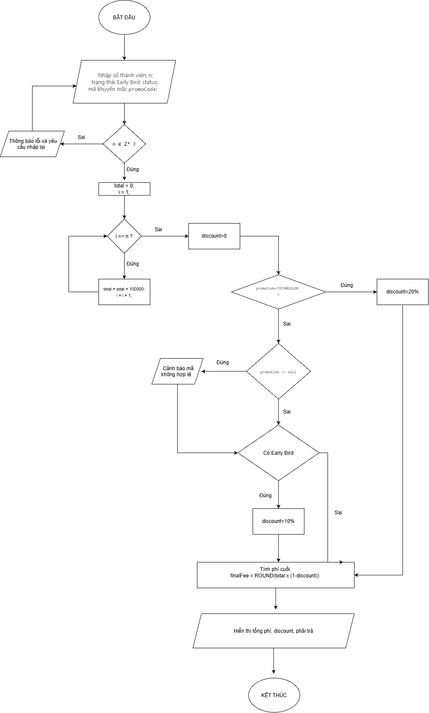

# TB-01 — Flowchart tính phí đăng ký Hackathon TechBugs

## 1. Mục tiêu

Mô tả luồng tính tổng phí đăng ký theo **bố cục từ trên xuống (top-down)**, dễ theo dõi và đúng yêu cầu đề bài: có **cấu trúc lặp** để cộng phí theo số lượng thành viên, và có **cấu trúc điều kiện** để áp dụng Early Bird hoặc mã khuyến mãi.

## 2. Quy tắc nghiệp vụ

Do đề bài chưa cho sẵn giá trị cụ thể, tài liệu này sử dụng các giả định sau:

- Phí mỗi thành viên: **100.000 VNĐ**
- Early Bird: **giảm 10%**
- Mã khuyến mãi hợp lệ: **TECHBUGS20**
- Mã hợp lệ giảm: **20%**
- **Không cộng dồn ưu đãi**; nếu mã hợp lệ thì ưu tiên mã, nếu không thì xét Early Bird
- Số lượng thành viên phải là **số nguyên dương**

## 3. Flowchart

## 4. Giải thích ngắn gọn

1. Người dùng nhập số thành viên, trạng thái Early Bird và mã khuyến mãi.
2. Hệ thống kiểm tra `n` có hợp lệ hay không. Nếu sai thì báo lỗi và nhập lại.
3. Nếu hợp lệ, hệ thống dùng vòng lặp để cộng phí cho từng thành viên.
4. Sau khi có tổng phí gốc, hệ thống kiểm tra mã khuyến mãi.
5. Nếu mã không hợp lệ hoặc không có mã, hệ thống tiếp tục xét Early Bird.
6. Tính số tiền cuối cùng và hiển thị kết quả.

## 5. Ca kiểm thử mẫu

| Số thành viên | Early Bird | Mã | Kết quả |
|---:|---|---|---:|
| 3 | Không | Trống | 300.000 VNĐ |
| 3 | Có | Trống | 270.000 VNĐ |
| 3 | Không | TECHBUGS20 | 240.000 VNĐ |
| 3 | Có | TECHBUGS20 | 240.000 VNĐ |
| 3 | Có | ABC123 | 270.000 VNĐ + cảnh báo mã sai |

